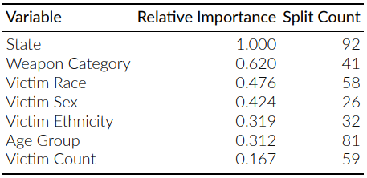
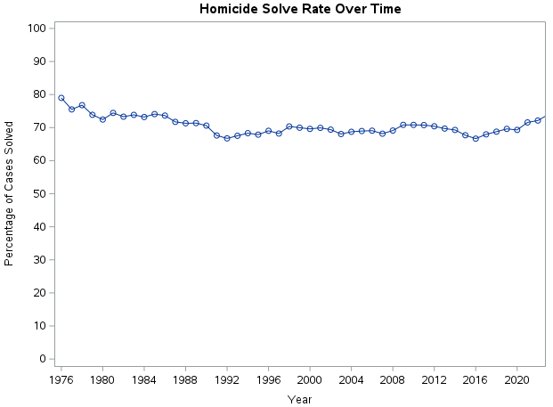
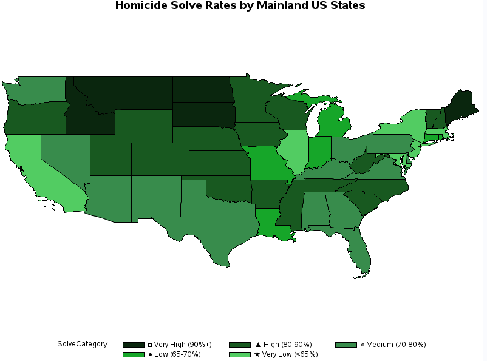

# Predicting homicide case outcomes in the USA

Can you predict whether a US homicide case will be solved from the details of the case? I compared three models in SAS on about 880,000 homicide records from 1976 to 2023: logistic regression, a classification tree and a neural network. This was a university project (AMA3011).

## Results

Tested on 264,278 held-out cases (70/30 split), using a 0.65 probability cutoff for "solved".

| Model | Accuracy | Sensitivity | Specificity | AUC |
|---|---|---|---|---|
| Logistic regression | 67.8% | 75.1% | 49.8% | 0.677 |
| Classification tree | 68.3% | 75.6% | 50.2% | 0.681 |
| Neural network | 68.3% | 75.3% | 51.2% | 0.690 |

Sensitivity is the share of solved cases the model gets right. Specificity is the same for unsolved cases.

The three models are very close, with the neural network slightly ahead on AUC. All three catch about 75% of solved cases but only about half of the unsolved ones, so cases that go cold are hard to predict from this data. Results on the training and test sets were almost identical (AUC within 0.002), so none of the models are overfitting.

71% of all cases in the data are solved (625,679 out of 880,928). That means accuracy on its own is a poor measure here: always guessing "solved" would be right 71% of the time and would never flag an unsolved case. The 0.65 cutoff is there to balance catching both kinds, which is why sensitivity and specificity are reported alongside accuracy.

## What mattered most

State and weapon type were the most influential variables in both the logistic regression and the tree, ahead of victim characteristics.

- Solve rates range from 39.7% in the District of Columbia to 93.0% in South Dakota, and are lower in more densely populated states (one-way ANOVA, F(2,47) = 25.04, p < 0.001).
- Solve rates fell from around 80% in the late 1970s to the low 70s today.
- Cases with female victims are solved more often than cases with male victims (78.6% against 68.9%).

## Limits

The data relies on what police report. Offender details were left out because they are usually missing in unsolved cases, and narrative fields like case notes are not used. The report also discusses practical uses, such as flagging cases likely to stall early and comparing solve rates between agencies, and the ethical problem of de-prioritizing cases because a model says they are unlikely to be solved.

## Files

| File | What it is |
|---|---|
| `Predicting_Murder_in_the_USA.pdf` | The full report (84 pages) |
| `Predicting_Murder.sas` | SAS code for cleaning, exploration and all three models |

## Running it

You need SAS. The data is the Supplementary Homicide Report from the Murder Accountability Project (1976 to 2023), which is not included here. The code reads it from a CSV and uses file paths from my SAS environment, so change those at the top first.
